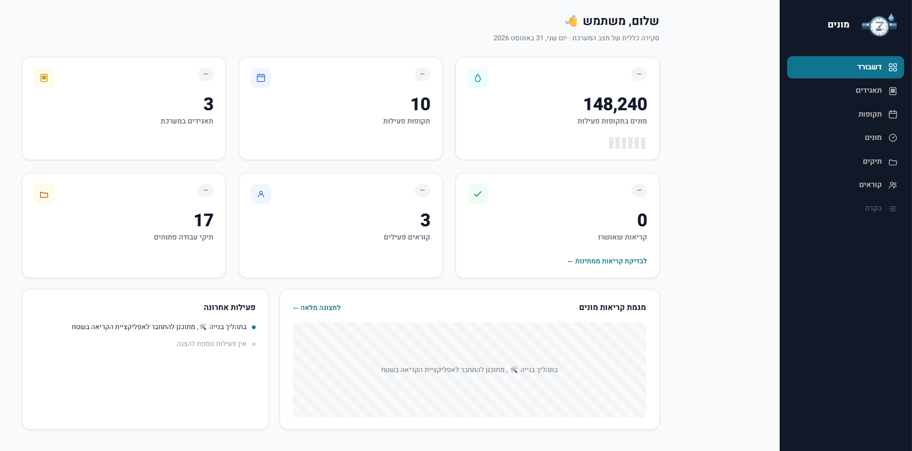
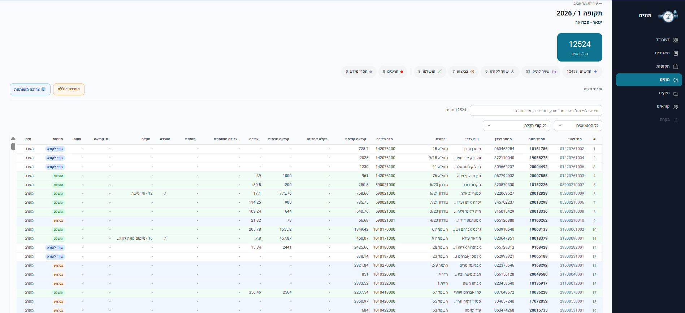
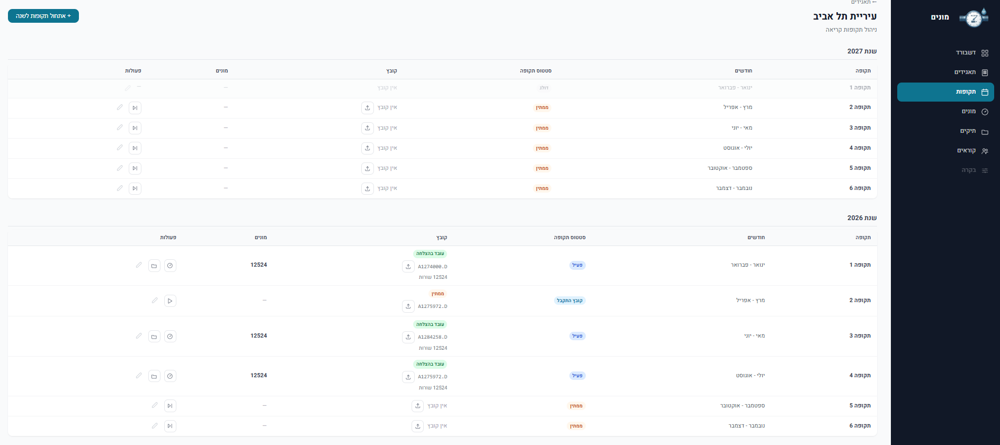
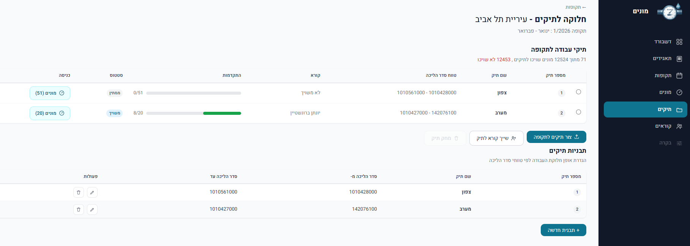
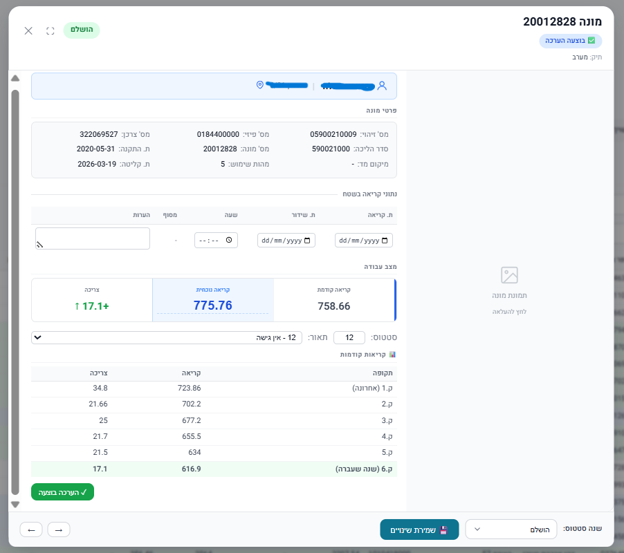

# Monim: Operational Water Meter Management System

> Full-stack operational system for managing periodic water meter reading workflows.
> Built with Python, Flask, and PostgreSQL (no ORM).  
> **Status: In Development**

## Overview

**Monim** is a backend-driven operational system for managing large-scale water meter reading workflows.

Israeli water corporations operate in a bi-monthly cycle, processing tens of thousands of meters per period. The system ingests raw data files from external sources (both modern Excel exports and legacy fixed-width DOS files), transforms them into structured operational entities, distributes work across field teams by walk-order, and tracks execution through validation and approval stages.

The project focuses on **data modeling, workflow orchestration, and system architecture**, reflecting real operational complexity; including messy legacy file formats, edge-case-heavy business rules, and a strictly enforced write-path (rather than a simple CRUD app).  This is a ground-up rebuild (V2), with a stricter layered architecture and validated business logic.

---

## Screenshots

<div align="center">
<table>
<tr>
  <td align="center"><b>Dashboard</b></td>
  <td align="center"><b>Meters</b></td>
</tr>
<tr>
  <td></td>
  <td></td>
</tr>
<tr>
  <td align="center"><b>Periods & File Processing</b></td>
  <td align="center"><b>Work Folder Distribution</b></td>
</tr>
<tr>
  <td></td>
  <td></td>
</tr>
<tr>
  <td colspan="2" align="center"><b>Meter Detail : Reading History & Fault Codes</b></td>
</tr>
<tr>
  <td colspan="2" align="center"></td>
</tr>
</table>
</div>
---

## Core Workflow

```
Corporation → File Upload → Parser → Period Meters → Work Folders → Readings → Approval
```

1. **Reading period created** for a corporation (6 bi-monthly periods per year)
2. **Source file uploaded**: either the corporation's Excel export or a legacy fixed-width DOS file
3. **File parsed and validated** into normalized `period_meters` rows; rows missing required fields are flagged `missing_info`, rows with no meter number are skipped
4. **Meters distributed** into work folders by walk-order ranges
5. **Readers assigned** to folders
6. **Field readings collected** readers report meter values
7. **Shared consumption calculated** for multi-apartment buildings (see below)
8. **Quality control** manager reviews, approves or rejects readings

---

## Architecture

```
┌────────────────────────────────────────────────────┐
│                   Flask UI                         │
│         Templates · Routes · Static                │
├────────────────────────────────────────────────────┤
│                Service Layer                       │
│   Validation · Business Rules · Orchestration      │
│                                                    │
│  ClientService     ReaderService    ReadingService │
│  PeriodService     MeterService     FolderService  │
│  SourceFileService TemplateService  PhotoService   │
│  SharedConsumptionService                          │
├────────────────────────────────────────────────────┤
│              Repository Layer                      │
│        CRUD · Queries · No Business Logic          │
├────────────────────────────────────────────────────┤
│           PostgreSQL + Connection Pool             │
│      10 Tables · Indexes · FK Constraints          │
└────────────────────────────────────────────────────┘
```

**Layer Responsibilities**

| Layer | Responsibilities |
|-------|------------------|
| **Database** | PostgreSQL relational schema, connection pooling via a singleton, strong use of constraints/FKs/indexes, clear separation between current state and historical data |
| **Repository** | Direct database access only (one repository per table, no business logic) |
| **Service** | Business logic, validation, orchestration |
| **Web (Flask)** | Routes, HTTP handling, Jinja2 rendering - Hebrew RTL |

**Design Principles**

- **No ORM**: direct SQL for full control and transparency
- **Strict write rule**: services read from any repository, but every write (INSERT/UPDATE/DELETE) must go through the entity's *owning* service, never a foreign repository directly. Audited end-to-end across the codebase.
- **Three data layers**: source data (corporation file), current state (`period_meters`), and history (`readings`) are kept fully separate
- **Data integrity enforced at both DB and service layers** : constraints, validations, and business rules at every level

---

## Data Model

10 tables organized in three groups:

**Core master data:** `clients`, `readers`, `folder_templates`, `fault_codes`
**Operational cycle:** `reading_periods`, `period_source_files`, `period_meters`, `work_folders`
**Field execution:** `readings`, `photos`

```
ReadingPeriod
   ├── PeriodSourceFile        (corporation file: Excel or DOS)
   ├── PeriodMeters            (all meters: current state)
   │       └── Readings        (reading history, append-only)
   │               └── Photos
   └── WorkFolders             (work assignments, from FolderTemplates)
```

| Entity | Description |
|--------|-------------|
| **Client** | Water corporation |
| **ReadingPeriod** | Bi-monthly operational time window |
| **PeriodSourceFile** | Raw data file uploaded for a period |
| **PeriodMeter** | Central entity, a meter within a specific period, holding both source data and live work state |
| **WorkFolder** | Batch of meters assigned for field work |
| **FolderTemplate** | Reusable work division by walk-order ranges |
| **Reader** | Field worker performing readings |
| **Reading** | Individual meter reading event (historical record) |
| **Photo** | Visual documentation attached to a reading |
| **FaultCode** | Lookup table of ~40 field-exception codes (broken meter, no access, buried meter, etc.) |

### Key Design Decisions

- `PeriodMeter` is the central operational entity: it holds both imported base data and current work state
- `Reading` stores historical events separately from current state; each reading is a snapshot, `PeriodMeter` is always the latest state
- Folder assignment is enforced via a **composite foreign key** ensuring a meter and its folder always belong to the same period; a meter can never be assigned to a folder from a different reading period
- **Shared consumption is grouped by a prefix of the meter ID, not by address.** An early version grouped apartments by address, which broke down in practice: the address format (`street apartment/building`) caused apartments from different buildings to collide under the same address key. The fix groups meters by the first 8 digits of the meter ID (`[street][building]`), which is unambiguous where address strings are not.

---

## File Processing & Parsing

The system includes an extensible parser mechanism supporting two source formats from the same corporation:

- `BaseParser` : abstract interface every format-specific parser implements
- `NetanyaParser` : modern Excel export format
- `NetanyaDParser` : legacy fixed-width DOS format (`cp862` encoding, RTL Hebrew stored reversed in fixed-width fields, historical-reading columns used for consumption estimates)
- A parser registry (`get_parser_for_type`) maps `file_type` to the correct parser

**Capabilities:**
- Handles data quality issues: missing fields, `#N/A` values, mixed types, legacy fixed-width encoding quirks
- Rows without a meter number are skipped, with detailed reporting
- Rows with missing optional fields are imported with `work_status = 'missing_info'` and `raw_data.missing_fields` listing exactly what's missing
- Files with under 5% skipped rows are marked `success`; 5%+ are marked `partial`
- Failed processing is saved with error details and supports retry

---

## Web Interface (Flask)

Hebrew RTL admin interface with 6 core screens plus a dashboard:

| Screen | Functionality |
|--------|----------------|
| **Dashboard** | KPI overview across clients, periods, meters, folders, readers, readings |
| **Clients** | CRUD management, click-through to periods |
| **Periods** | Period lifecycle, file upload (Excel or DOS), processing with status feedback, retry on error |
| **Meters** | Large-scale meter view with status cards, filtering, search, pagination, detail modal, manual estimate & shared-consumption triggers |
| **Folders** | Template management, folder creation, meter distribution with progress bars, plus a global cross-client folders overview |
| **Readers** | Reader management, folder assignment, expandable detail panels |

**UI Features:** modals for create/edit, flash messages, status badges with color coding, client-side filtering/search without page reload, accordion panels, pagination for large datasets.

---

## Testing

190+ automated tests covering business logic, edge cases, and full end-to-end integration flows, run against a dedicated, auto-reset test database. Every service-layer entity has its own dedicated test suite, alongside parser suites for both the Excel and legacy DOS formats and a full pipeline integration suite. Test fixtures are fully synthetic: anonymized data modeled on real water-corporation export files.

### Running tests
<details>
<summary>Test commands</summary>
Tests are standalone scripts, **not** run with `pytest`, run directly as Python modules:

```bash
# Service-layer tests
python -m tests.services_tests.test_flow
python -m tests.services_tests.test_client_errors
python -m tests.services_tests.test_period_errors
python -m tests.services_tests.test_source_file_errors
python -m tests.services_tests.test_meter_errors
python -m tests.services_tests.test_folder_errors
python -m tests.services_tests.test_reading_errors
python -m tests.services_tests.test_shared_consumption

# Parser tests
python -m tests.parsing_tests.test_netanya_parser
python -m tests.parsing_tests.test_dos_parser
python -m tests.parsing_tests.test_process_uploaded_file
```
</details>

---

## Project Structure

```
Monim/
├── app.py                  # Flask application entry point, blueprint registration
├── database/               # PostgreSQL schema & connection
├── routes/                 # Flask blueprints 
├── src/
│   ├── repositories/       # Data access layer 
│   ├── services/           # Business logic layer 
│   └── parsers/            # Source-file (extensible) parser system
├── templates/              # Jinja2 templates / Hebrew RTL UI
├── static/                 # CSS, JS, uploads
├── tests/                  # Service, parser, and integration tests 
├── scripts/                # Development / demo utilities
└── requirements.txt
```

---

## Tech Stack

| Component | Technology |
|-----------|------------|
| Language | Python 3.10 |
| Database | PostgreSQL 17 |
| DB Access | psycopg2 (connection pool, no ORM) |
| Web Framework | Flask |
| Templates | Jinja2 |
| File Parsing | openpyxl (Excel) + custom fixed-width/cp862 handling (DOS) |
| Testing | Custom test runner (no external framework) | 

---

## Setup

### Prerequisites
- Python 3.10+
- PostgreSQL 17

### Installation
<details>
<summary>Installation commands</summary>

```bash
# Clone
git clone https://github.com/YOUR_USERNAME/monim.git
cd monim

# Virtual environment
python -m venv .venv
.venv\Scripts\activate        # Windows
# source .venv/bin/activate   # Linux/Mac

# Dependencies
pip install -r requirements.txt

# Database
# (The application requires two PostgreSQL databases: one for development and one for automated tests)
psql -U postgres -c "CREATE DATABASE monim_v2"
psql -U postgres -c "CREATE DATABASE monim_v2_test"
psql -U postgres -d monim_v2      -f database/schema.sql
psql -U postgres -d monim_v2_test -f database/schema.sql

# Environment
cp .env.example .env
# fill in your local DB credentials

# Run
python app.py
# Open http://localhost:5000
```
</details>

---

> Note: AI-assisted development techniques were used selectively (primarily for UI development, documentation, and test scaffolding) using Claude Code, while all system design decisions, architecture, and core business logic were designed and implemented manually.
